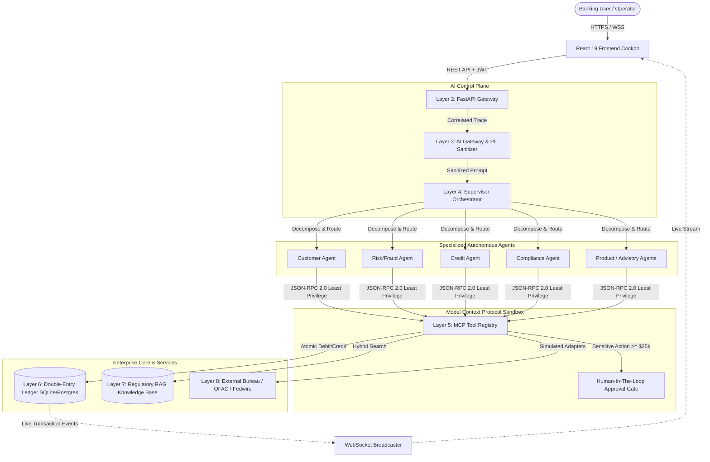

# WrenchWise Banking Platform
### Simulated Real-Time Banking Architecture with Multi-Agent AI Automation

[](https://fastapi.tiangolo.com/)
[](https://react.dev/)
[](https://tailwindcss.com/)
[%20%2F%20PostgreSQL-003B57?style=flat&logo=sqlite)](https://sqlite.org/)
[](https://scikit-learn.org/)
[](https://pytest.org/)

---

## Table of Contents

1. [Project Title and Introduction](#1-project-title-and-introduction)
2. [Project Objectives](#2-project-objectives)
3. [Key Features](#3-key-features)
4. [Technology Stack](#4-technology-stack)
5. [System Architecture](#5-system-architecture)
6. [Project Structure](#6-project-structure)
7. [Installation and Setup](#7-installation-and-setup)
8. [How to Use the Application](#8-how-to-use-the-application)
9. [Sample Use Cases](#9-sample-use-cases)
10. [Testing](#10-testing)
11. [Security and Limitations](#11-security-and-limitations)
12. [Future Enhancements](#12-future-enhancements)
13. [What I Learned](#13-what-i-learned)
14. [Author and Acknowledgment](#14-author-and-acknowledgment)
15. [License](#15-license)

---

## 1. Project Title and Introduction

**WrenchWise Banking Platform — Simulated Real-Time Banking Architecture with Multi-Agent AI Automation** is a full-stack, simulated enterprise banking system developed as part of an **AI/ML Internship technical assignment for Wrench Wise EduTech Pvt. Ltd.**

### The Problem It Solves

Modern banking platforms face dual pressures: customers demand instantaneous, personalized financial interactions through natural conversation, while compliance, risk, and ledger integrity demand zero tolerance for error. When engineering teams attempt to integrate Large Language Models (LLMs) directly into financial operations, critical risks emerge:
- **Hallucination Risk**: An AI agent cannot be trusted to directly issue SQL updates or debit customer accounts based on unconstrained probabilistic text generation.
- **Security & Privacy Breaches**: Sensitive financial identifiers (PANs, SSNs) can easily leak into prompt logs, and adversarial prompt injection can manipulate transaction workflows.
- **Opaque Auditing**: Regulators require explainable, deterministic trails for every routing decision, fraud assessment, and fund transfer.

### The Purpose of This Project

The WrenchWise Banking Platform bridges this gap. It simulates an enterprise banking architecture that combines **multi-agent AI workflow orchestration** with **deterministic transactional safety**. 

AI agents reason, categorize customer intent, look up regulatory frameworks, and run machine learning fraud models, but they **never directly mutate account records**. Every balance mutation is enforced by an atomic, double-entry ledger that runs behind sandboxed **Model Context Protocol (MCP)** tool gateways with strict permission boundaries and Human-In-The-Loop (HITL) approval gates.

---

## 2. Project Objectives

1. **Demonstrate Multi-Agent Collaboration**: Showcase how specialized autonomous agents can coordinate on complex, multi-step banking tasks rather than relying on a single monolithic prompt.
2. **Implement Supervisor/Orchestrator Routing**: Build an intelligent Layer 4 Supervisor engine that parses natural language queries, classifies intent, generates a Directed Acyclic Graph (DAG) of subtasks, and routes them to the appropriate specialized agents.
3. **Deploy Domain-Specific Autonomous Agents**: Implement specialized agents focusing on distinct functional domains:
   - *Customer Service*: 360-degree customer profiling, KYC checks, and balance inquiries.
   - *Banking Products & Advisory*: Deposit accounts, CD tiers, card services, and wealth advisory.
   - *Risk & Fraud Analysis*: Multi-model anomaly detection, transaction velocity checks, and geo-risk evaluation.
   - *Credit & Loan Assistance*: Debt-to-income (DTI) calculations, credit bureau integration, and loan underwriting.
   - *Compliance & Document Handling*: Anti-Money Laundering (AML), OFAC sanctions screening, and regulatory policy search.
4. **Reliable Natural Language Interaction**: Support natural language banking interactions through a configurable LLM adapter (compatible with Google Gemini models) paired with an automated **deterministic rule-based fallback**, ensuring the entire application functions 100% reliably even without an external API key.

---

## 3. Key Features

### Implemented Features

- **Intuitive Web Cockpit**: Modern, responsive dashboard built with React 19 and Tailwind CSS v4, featuring 15+ dedicated operational views including Accounts, Transfers, Double-Entry Ledger, Agent Command Center, Risk Simulator, RAG Knowledge Explorer, and Audit Logs.
- **Simulated Core Banking API**: Complete account management with checking and savings accounts, realistic account numbers, synthetic customer profiles, and balance locks.
- **Atomic Double-Entry Bookkeeping**: Strict financial ledger where every credit has an equal and opposite debit ($\Sigma \text{Debits} = \Sigma \text{Credits}$), preventing money from being created or destroyed.
- **Supervisor-Driven Multi-Agent Orchestrator**: Intent classifier and task decomposition engine coordinating 9 specialized agents with step-by-step trajectory capture.
- **Model Context Protocol (MCP) Sandbox**: A centralized registry of 12 sandboxed banking tools exposed via JSON-RPC 2.0 with least-privilege role-based access control (RBAC).
- **Risk & Fraud Anomaly Pipeline**: Trio of anomaly detection models (Rule-Based, Isolation Forest, and Random Forest Ensemble) trained on transaction feature vectors with real-time drift monitoring (Population Stability Index).
- **Human-In-The-Loop (HITL) Review Gate**: Automatic ticket creation and execution pause whenever transactions exceed thresholds ($\ge \$25,000$, fraud score $\ge 75/100$, or sanctions match).
- **Hybrid Regulatory Knowledge Engine (RAG)**: Combined Okapi BM25 and vector cosine similarity with Reciprocal Rank Fusion (RRF) reranking over banking regulations (FATF, OFAC, BCBS, FinCEN).
- **Security & PII Sanitization**: High-performance regex filtering that masks credit card numbers (PANs) and Social Security Numbers (SSNs), accompanied by prompt injection defense guards.
- **Real-Time Event Streaming**: In-memory event bus and WebSocket broadcaster (with Redis Streams support in Docker) streaming live audit and transaction updates.

### Planned / Conceptual Features (Future Roadmap)

- Live client integration with real third-party aggregators (e.g., Plaid, Stripe Treasury).
- Production biometric and hardware token Multi-Factor Authentication (MFA).
- Real-time automated regulatory SAR (Suspicious Activity Report) e-filing.
- Distributed consensus clustering across multi-region nodes.

---

## 4. Technology Stack

Every component in the repository is selected to mirror real-world financial architectures:

| Category | Technology | Version | Role in Project |
| :--- | :--- | :--- | :--- |
| **Backend Framework** | [FastAPI](https://fastapi.tiangolo.com/) | `>= 0.110.0` | Asynchronous REST and WebSocket API gateway with automated OpenAPI documentation. |
| **ASGI Server** | [Uvicorn](https://www.uvicorn.org/) | `>= 0.28.0` | High-performance asynchronous server handling HTTP and WebSocket traffic. |
| **Data Validation** | [Pydantic v2](https://docs.pydantic.dev/) | `>= 2.6.4` | Strict schema validation, request/response models, and settings management. |
| **Database ORM** | [SQLAlchemy](https://www.sqlalchemy.org/) | `>= 2.0.28` | Async ORM managing relational schemas, session transactions, and balance locks. |
| **Database Drivers** | [aiosqlite](https://aiosqlite.omnilib.dev/) / [asyncpg](https://github.com/MagicStack/asyncpg) | `>= 0.20.0` | Async driver for default SQLite local dev file (`banking.db`) and PostgreSQL in Docker. |
| **Machine Learning** | [scikit-learn](https://scikit-learn.org/) & [NumPy](https://numpy.org/) | `1.4.1` / `1.26.4` | Fraud anomaly detection (Isolation Forest, Random Forest) and feature vector math. |
| **Security & Auth** | [python-jose](https://github.com/mpdman/python-jose) & [passlib](https://passlib.readthedocs.io/) | `3.3.0` / `1.7.4` | JWT token generation/validation, bcrypt password hashing, and RBAC enforcement. |
| **Frontend UI** | [React](https://react.dev/) | `19.2.8` | Component-based interactive banking cockpit and agent observability dashboard. |
| **Language & Bundler** | [TypeScript](https://www.typescriptlang.org/) & [Vite](https://vite.dev/) | `~6.0.2` / `^8.3.0` | Type-safe frontend client development with hot-module replacement and production bundling. |
| **Styling** | [Tailwind CSS](https://tailwindcss.com/) | `^4.3.3` | Modern utility-first CSS framework for clean, enterprise-grade dark/light layouts. |
| **Data Visualization** | [Recharts](https://recharts.org/) & [Lucide React](https://lucide.dev/) | `^3.10.1` / `^1.55.0` | Real-time telemetry charts, risk trend graphs, and accessible UI icons. |
| **Automated Testing** | [Pytest](https://pytest.org/) & [pytest-asyncio](https://pytest-asyncio.readthedocs.io/) | `>= 8.1.1` | Comprehensive automated test suite spanning unit, integration, and E2E acceptance tests. |
| **Containerization** | [Docker](https://www.docker.com/) & Docker Compose | Compose `v3.8` | Containerized deployment linking PostgreSQL 16 (`pgvector`), Redis 7, backend, and Nginx. |

---

## 5. System Architecture

The WrenchWise Banking Platform is designed around a decoupled, layered pipeline. User interactions flow from the browser through security checkpoints before reaching AI agents, and agent decisions pass through sandboxed tool protocols before reaching the database.

### Architectural Flow

1. **Client to API Gateway**: The React frontend issues authenticated HTTPS requests or opens a WebSocket channel. The FastAPI backend validates JWT tokens, applies rate limits, and attaches a correlation trace ID.
2. **AI Control Plane (Sanitization)**: User queries pass through Layer 3. PII (account numbers, SSNs) is masked, and prompt injection attempts are detected and defused.
3. **Supervisor Orchestration**: Layer 4 classifies the request's intent, builds an execution plan, and invokes the relevant specialized agents.
4. **Sandboxed MCP Execution**: When an agent needs information (like an account balance or fraud score), it calls an authorized tool via JSON-RPC 2.0 in Layer 5. Tools verify agent permissions, call internal repositories or simulated external services (Credit Bureau, OFAC), and return structured outputs.
5. **Double-Entry Ledger & Response**: If money is transferred, Layer 6 executes atomic ledger legs in a single database transaction. The agent compiles the results and returns a structured response with complete trajectory steps to the frontend.

### Mermaid Architecture Diagram



---

## 6. Project Structure

The repository is organized into a clean decoupled monorepo separating the Python backend from the React frontend:

```text
WrenchWise-Project/
├── .env.example                # Template for environment configuration
├── docker-compose.yml          # Container configuration (Postgres, Redis, API, UI)
├── README.md                   # Complete system documentation
│
├── backend/                    # Core Python / FastAPI Banking Engine
│   ├── Dockerfile              # Container recipe for backend service
│   ├── pytest.ini              # Pytest configuration settings
│   ├── requirements.txt        # Backend dependencies
│   ├── verify_live_api.py      # Standalone API health verification script
│   │
│   ├── app/                    # Primary application package
│   │   ├── config.py           # Pydantic environment settings
│   │   ├── database.py         # SQLAlchemy async engine and session maker
│   │   ├── main.py             # FastAPI entrypoint, lifespan events, and routers
│   │   │
│   │   ├── api/                # REST & WebSocket Route Handlers
│   │   │   ├── v1/             # Accounts, transactions, agents, HITL, RAG, MCP routes
│   │   │   └── websockets.py   # Live event streaming manager
│   │   │
│   │   ├── core/               # Security, JWT auth, and event bus infrastructure
│   │   ├── ml/                 # Fraud anomaly models (Isolation Forest, Random Forest)
│   │   ├── models/             # SQLAlchemy ORM database models
│   │   ├── schemas/            # Pydantic data schemas
│   │   │
│   │   └── layers/             # Nine-Layer Architecture Implementation
│   │       ├── l2_gateway/     # WAF rules, rate limiting, and request correlation
│   │       ├── l3_ai_control_plane/ # PII masking, token accounting, safety checks
│   │       ├── l4_orchestrator/     # Supervisor, agent catalog, and 9 agent definitions
│   │       ├── l5_mcp_tools/        # 12 sandboxed tools and JSON-RPC 2.0 server
│   │       ├── l6_enterprise_data/  # Double-entry ledger engine and repository
│   │       ├── l7_rag_knowledge/    # BM25 + Vector hybrid regulatory search
│   │       └── l8_external_services/# Mock adapters for Credit Bureau, OFAC, Fedwire
│   │
│   └── tests/                  # Automated Pytest Suite (46 Test Cases)
│       ├── test_banking_engine.py      # Ledger, transfer, and account tests
│       ├── test_multi_agent.py         # Supervisor routing and agent coordination
│       ├── test_prompt4_mcp_rag_ml.py  # MCP tools, RAG search, and ML benchmarks
│       └── test_prompt5_e2e_acceptance.py # End-to-end acceptance scenarios
│
└── frontend/                   # Modern React Cockpit
    ├── Dockerfile              # Multi-stage production build recipe
    ├── nginx.conf              # Nginx server configuration for containerized UI
    ├── package.json            # Node dependencies and scripts
    ├── vite.config.ts          # Vite build and proxy settings
    │
    └── src/
        ├── App.tsx             # Main dashboard layout and navigation state
        ├── components/         # 25+ View Components (Accounts, Transfers, Command Center, etc.)
        ├── context/            # Authentication and WebSocket contexts
        └── services/           # Axios/Fetch API client wrappers
```

---

## 7. Installation and Setup

### Prerequisites

Ensure the following tools are installed on your workstation:
- **Python**: Version `3.11` or higher
- **Node.js**: Version `20.x` or higher (along with `npm`)
- **Git**: For source version control
- *(Optional)* **Docker & Docker Compose**: If you prefer containerized deployment

---

### Method A: Local Development Setup (Recommended)

#### Step 1: Clone and Configure Environment

```bash
git clone <your-repository-url> WrenchWise-Project
cd WrenchWise-Project

# Copy the example environment file
cp .env.example .env
```

The default `.env` configuration uses local SQLite (`sqlite+aiosqlite:///./banking.db`) and the deterministic fallback engine, so **no external API keys or cloud databases are required** to get started.

#### Step 2: Set Up and Start Backend

Open a terminal in the project root:

```bash
# Navigate to backend directory
cd backend

# Create a virtual environment
python -m venv venv

# Activate virtual environment:
# On Windows (PowerShell):
.\venv\Scripts\Activate.ps1
# On Windows (Command Prompt):
.\venv\Scripts\activate.bat
# On Linux / macOS:
# source venv/bin/activate

# Install Python dependencies
pip install -r requirements.txt

# Start FastAPI development server
uvicorn app.main:app --host 127.0.0.1 --port 8000 --reload
```

When the backend starts, it automatically creates the SQLite database tables and seeds synthetic demo customers and accounts.
- **Backend API**: `http://127.0.0.1:8000`
- **Interactive Swagger Docs**: `http://127.0.0.1:8000/docs`

#### Step 3: Set Up and Start Frontend

Open a second terminal in the project root:

```bash
# Navigate to frontend directory
cd frontend

# Install Node dependencies
npm install

# Start Vite development server
npm run dev
```

- **Frontend Application**: `http://localhost:5173`

---

### Method B: Docker Compose Deployment

If you prefer running the full multi-service stack (including PostgreSQL 16 with `pgvector` and Redis 7):

```bash
# From project root
docker compose up --build -d
```

To monitor running containers:

```bash
docker compose ps
docker compose logs -f backend
```

---

## 8. How to Use the Application

### 1. Launching and Logging In
1. Open your browser and navigate to `http://localhost:5173`.
2. The platform provides pre-seeded demo user accounts. You can log in using:
   - **Demo Admin / RM**: `admin@horizonbank.com` (or use the one-click demo credentials on the login screen).

### 2. Exploring Core Banking Operations
- **Accounts & Balances**: View checking and savings liquidity, account numbers, and status.
- **Fund Transfers**: Execute transfers between accounts. Notice that entering an Idempotency Key prevents duplicate transfers if you submit repeatedly.
- **Double-Entry Ledger View**: Inspect the real-time balanced journal legs generated for every financial movement.

### 3. Using the Multi-Agent Command Center
1. Navigate to the **Agent Command Center** in the sidebar.
2. Type a natural language banking prompt into the query bar, or click one of the pre-configured workflow presets (such as *"Check balance for John Doe"* or *"Suspicious wire to offshore account"*).
3. Click **Execute Workflow**.
4. Observe the **Agent Trajectory Viewer**:
   - The **Supervisor** classifies the intent and plans execution steps.
   - Designated agents execute authorized tools.
   - Safety checks evaluate fraud risk and PII masking in real time.
   - The final synthesised answer is returned with an audit log.

---

## 9. Sample Use Cases

Here are representative queries you can submit in the Command Center, reflecting implemented features:

### Use Case 1: Customer Information & Balance Inquiry
- **Prompt**: `"What is the available balance and KYC status for account ACC-1002341?"`
- **What Happens**: 
  1. The Supervisor routes the intent to the **Customer Agent**.
  2. The Customer Agent invokes `account_tool` and `crm_tool`.
  3. The agent retrieves the cleared balance, currency, and KYC verification tier.
  4. The response displays the verified balance and relationship tenure without sensitive credential leakage.

### Use Case 2: Banking Product & Savings Tier Inquiry
- **Prompt**: `"What are the current interest rates and minimum balances for High-Yield Savings versus Certificates of Deposit?"`
- **What Happens**:
  1. The Supervisor routes the query to the **Banking Product Agent**.
  2. The agent consults the product matrix via `loan_tool` / product catalog rules.
  3. Returns APY percentages, lock-in periods, and fee structures.

### Use Case 3: High-Risk Transaction & Fraud Detection
- **Prompt**: `"Wire $49,990 from ACC-1002341 to Nassau Maritime Holdings Ltd in the Bahamas."`
- **What Happens**:
  1. The Supervisor decomposes the task across three agents: **Customer Agent**, **Risk/Fraud Agent**, and **Compliance Agent**.
  2. The Risk Agent calls `transaction_tool` to compute velocity, geolocation distance, and anomaly scores.
  3. The Compliance Agent calls `aml_tool` to screen against simulated OFAC watchlists.
  4. Because the transaction exceeds the $\$25,000$ threshold and triggers high anomaly scores, execution is flagged: a **Human-In-The-Loop (HITL) approval ticket** is created, pausing autonomous clearing.

### Use Case 4: Credit & Loan Assistance Inquiry
- **Prompt**: `"Simulate loan underwriting for a $35,000 auto loan for customer with credit score 740 and annual income $85,000."`
- **What Happens**:
  1. The Supervisor engages the **Credit Agent**.
  2. The Credit Agent computes Debt-to-Income (DTI) ratio, queries the simulated credit bureau adapter via `credit_tool`, and evaluates risk tiers.
  3. Returns an indicative monthly payment, calculated APR, and underwriting eligibility.

---

## 10. Testing

The platform features an automated test suite verifying each layer of the architecture, from double-entry balance consistency to multi-agent DAG execution and security controls.

### Running the Test Suite

Run all tests from the `backend/` directory:

```bash
cd backend

# Execute all tests with detailed verbosity
python -m pytest tests/ -v
```

### Verified Test Results (46 / 46 Passing)

The test suite consists of 46 automated tests organized across five test files:

- **`tests/test_banking_engine.py` (10 tests)**:
  - Validates deposit and withdrawal balance consistency.
  - Verifies overdraft rejection with zero balance leakage.
  - Verifies atomic account-to-account transfers and balance locks.
  - Enforces idempotency key deduplication on repeated transfers.
  - Checks double-entry debit/credit parity ($\Sigma \text{Debits} = \Sigma \text{Credits}$).
  - Verifies general ledger reconciliation audits and JWT RBAC security.
- **`tests/test_multi_agent.py` (9 tests)**:
  - Validates supervisor intent routing for balance inquiries and loan simulations.
  - Tests multi-agent collaboration on suspicious transfers.
  - Enforces least-privilege tool authorization rejection.
  - Confirms deterministic fallback execution when offline.
  - Tests workflow cancellation and immutable audit logging.
- **`tests/test_prompt4_mcp_rag_ml.py` (12 tests)**:
  - Verifies all 12 MCP tools and their Pydantic schemas.
  - Tests JSON-RPC 2.0 protocol handlers (`initialize`, `tools/list`, `tools/call`).
  - Verifies high-value HITL ticket creation and fault injection (503/504/429 mock errors).
  - Validates BM25 + Vector cosine RAG retrieval and citation generation.
  - Tests ML model reproducibility (fixed seed 42) and live risk prediction.
- **`tests/test_prompt5_e2e_acceptance.py` (11 tests)**:
  - Validates End-to-End Acceptance Scenarios A through J.
  - Confirms PII masking on SSNs and payment cards.
- **`tests/test_api.py` (4 tests)**:
  - Tests `/health`, account listings, and end-to-end agent orchestration endpoints.

---

## 11. Security and Limitations

> [!WARNING]
> **SIMULATED APPLICATION NOTICE**: This project is an educational, simulated banking platform designed for technical evaluation and research into multi-agent AI systems. It is **NOT** a certified production banking system.

- **Do Not Enter Real Financial Credentials**: Never input genuine personal identification numbers (PINs), live bank account details, real Social Security Numbers, or real credit card credentials into this application.
- **Synthetic Data**: All account holders, transaction histories, credit scores, and regulatory documents are synthetic fixtures.
- **Simulated Third-Party APIs**: Interactions with credit bureaus, payment networks (Fedwire/ACH), and sanctions screening (OFAC) are handled by simulated mock adapters with configurable latencies and fault modes.
- **Production Integration Note**: Connecting an AI agent system to genuine core banking platforms (such as FIS, Fiserv, or Temenos) requires PCI-DSS compliance, hardware security modules (HSM), ISO 20022 messaging standards, and rigorous regulatory oversight.

---

## 12. Future Enhancements

While the current release demonstrates a complete 9-layer simulated architecture, several planned enhancements will extend its capabilities:

1. **Production LLM Fine-Tuning**: Fine-tune domain-specific small language models (SLMs) specifically on banking compliance taxonomy to reduce inference latency.
2. **Real-World Anomaly Datasets**: Benchmark fraud detection algorithms on anonymized production-scale datasets (such as the IEEE-CIS Fraud Detection dataset) to assess extreme class imbalance handling.
3. **Multi-Party Consensus Protocols**: Introduce Byzantine fault-tolerant voting among agents before any sensitive advisory recommendation is presented to customers.
4. **Hardware-Backed MFA**: Integrate WebAuthn / FIDO2 biometric authentication for high-value fund authorizations.
5. **Distributed Cluster Orchestration**: Package the system into Kubernetes Helm charts with horizontal pod autoscaling and Redis cluster support.

---

## 13. What I Learned

Building the WrenchWise Banking Platform provided valuable, hands-on experience in architecting resilient, production-inspired AI systems. Key insights gained during this project include:

- **Decoupling Probabilistic AI from Deterministic Ledgers**: The most crucial architectural decision was never letting an AI agent write SQL or modify balances directly. Sandboxing agents behind MCP tools and an atomic double-entry ledger guaranteed that even if an LLM hallucinates, financial data remains mathematically consistent.
- **Supervisor-Worker Agent Patterns**: Creating a supervisor agent that decomposes complex user queries into discrete subtasks made the multi-agent system far more reliable than attempting single-turn completions with massive prompts.
- **Security-First AI Engineering**: Designing regex-based PII sanitization and prompt injection filters before requests reach the model showed me how vital defense-in-depth is when deploying generative AI in regulated industries.
- **Full-Stack Systems Integration**: Bridging asynchronous Python backend services (FastAPI, SQLAlchemy, WebSockets) with a reactive, type-safe frontend (React 19, TypeScript, Tailwind CSS v4) reinforced the importance of clear API contracts and comprehensive automated testing.

---

## 14. Author and Acknowledgment

- **Author**: Golla Moulidhar
- **Project Context**: AI/ML Internship Technical Assignment
- **Organization**: Wrench Wise EduTech Pvt. Ltd.

Special thanks to the technical mentors and review team at **Wrench Wise EduTech Pvt. Ltd.** for setting comprehensive architectural requirements that inspired the design of this simulated banking platform.

---

## 15. License

*No license has been specified for this repository at this time. All rights are reserved by the author and Wrench Wise EduTech Pvt. Ltd. for educational and assessment review purposes.*
